# SafeScroll — parental controls for TikTok, Snapchat & Meta apps

SafeScroll applies strict, age-based rules on top of **TikTok, Snapchat, Instagram, Facebook, Messenger, Threads, WhatsApp and Meta AI**. Many rules are **locked** for younger ages, so even someone who knows the parent PIN can't switch them off. They can only be made stricter.

It has three layers. Use all three for the best coverage:

| Layer | Covers | Folder |
|---|---|---|
| 1. Browser extension | Web versions of every supported service (feed control, content filters, friend limits, time limits) | `extension/` |
| 2. Network blocklist | Native phone, tablet and desktop apps (whole-platform blocking) | `network/` |
| 3. Device lock-down | Stops the child removing the extension, using incognito or using another browser | `deploy/` |

## What the rules do at each age

| Setting | Under 13 | 13–15 | 16–17 | 18+ |
|---|---|---|---|---|
| All 8 platforms blocked | 🔒 on | – | – | – |
| For You / algorithmic feed | 🔒 off | off, can switch on **with limits** | off, can switch on **with limits** | on |
| Explore / Discover off | 🔒 | 🔒 | off | off |
| LIVE off | 🔒 | 🔒 | on | off |
| Search off | 🔒 | on | off | off |
| Friend suggestions / Quick Add hidden | 🔒 | 🔒 | on | off |
| Follow/add only for approved accounts | 🔒 | 🔒 | off | off |
| Comments hidden | 🔒 | on | off | off |
| Content filters | all 🔒 | all except profanity 🔒 | core categories 🔒 | extremism, self-harm, gore |
| Filtered posts | 🔒 removed | 🔒 removed | blurred | blurred |
| Daily limit / bedtime | — / 20:00–07:00 | 60 min / 21:30–07:00 | 120 min / 23:00–06:00 | none |

If the age is unknown or setup hasn't been done, the **strictest tier** applies.

### The For You feed: off, or on with limits
Parents can switch the For You feed on or off. Under 13 it is **locked off** and can't be switched on. From 13 up, switching it on puts it in **limited mode**. Limits are set by age, and parents can make them tighter but never looser:

| When For You is on | 13–15 | 16–17 | 18+ |
|---|---|---|---|
| Daily For You time | 15 min max | 30 min max | no limit |
| Forced break | 2 min every 5 min | 1 min every 10 min | none |
| Posts per day | 40 max | 100 max | no limit |
| Allowed hours | 15:00–20:00 | 07:00–22:00 | any time |
| Filters on the feed | all 10 categories, flagged posts removed | 9 categories (all but profanity), removed | account's normal filters |
| Comments, LIVE, Shop & ads on the feed | hidden | hidden | shown |

When any limit is reached, the feed closes and the child is offered the **Following** feed (accounts they follow) instead. Posts count once they're at least 60% on screen. Filtered posts don't count.

**Content filter categories:** self-harm & eating disorders, extremism & terrorism, hate & harassment, graphic violence & weapons, sexual content, drugs/alcohol/vaping, gambling & scams, dangerous challenges, grooming & stranger-contact phrases, and mature language. The filters catch common evasions such as leetspeak (`0nlyfans`), joined-up hashtags (`#racewar`) and accents. Parents can add their own words.

### How each feature works per platform
- **For You off:** TikTok goes to `/following`, Instagram to the Following feed, Facebook to the most-recent feed (`?sk=h_chr`) and Threads to `/following`. Snapchat Spotlight and Discover are blocked.
- **Limiting who they can friend:** "Follow", "Add Friend" and "Message" buttons are hidden everywhere except on profiles whose username is on the parent's approved list. Suggestion modules (Quick Add, People You May Know, Suggested for you) are also hidden.
- **Time limits:** screen time is counted across all supported sites together. When the daily limit runs out or bedtime starts, the sites are blocked.

## How to use

### 1. Install the extension
1. Download or clone this repository.
2. Open `chrome://extensions` (or `edge://extensions`) and turn on **Developer mode** (top right).
3. Click **Load unpacked** and choose the `extension/` folder. The setup page opens by itself.

### 2. Create a PIN and enter the age
Pick a PIN of at least 6 digits that your child doesn't know, and enter their age. Until this step is finished, every supported app is blocked.

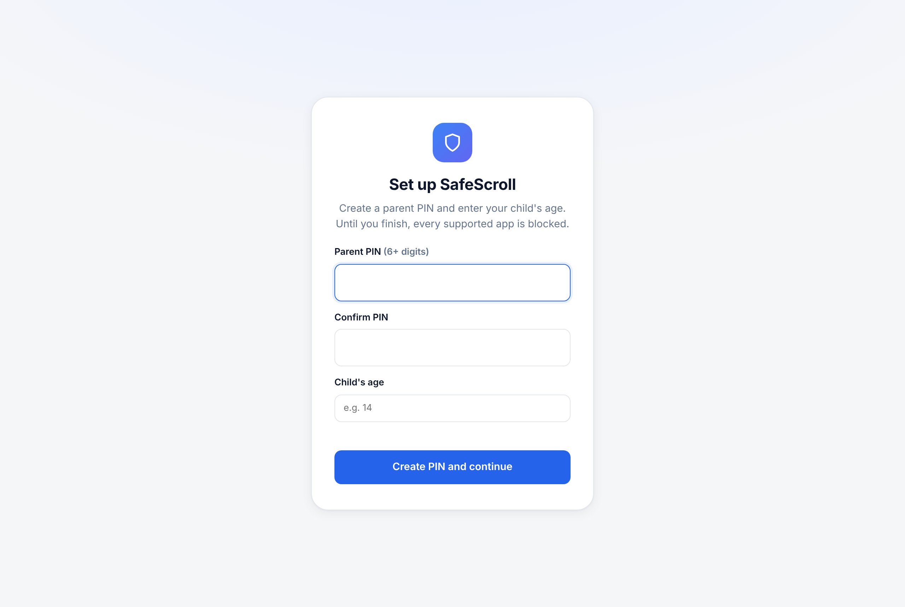

### 3. Review the rules
The dashboard has one card per area. Use the menu on the left to jump between them. The age stepper at the top picks the rules. Anything marked **🔒 Required** is locked for that age and its switch can't be turned off.

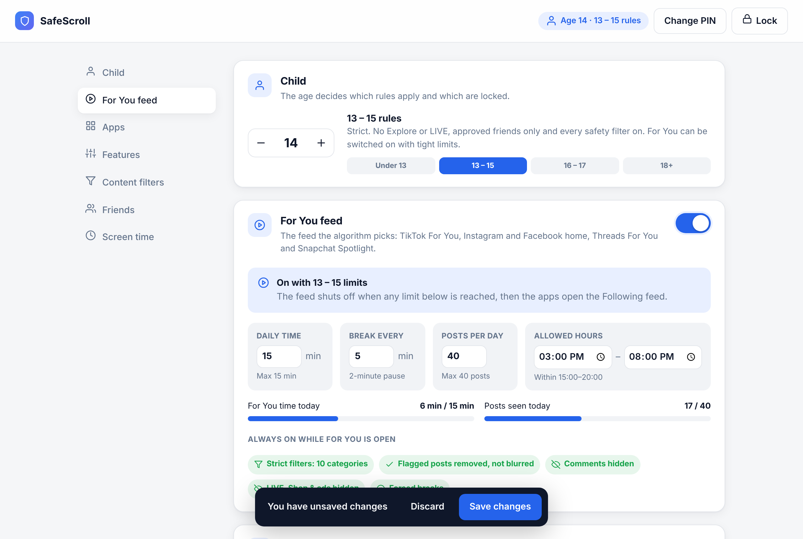

### 4. Decide about the For You feed
- **Off (the default for 13–17):** TikTok, Instagram, Facebook and Threads open the Following feed, and Snapchat Spotlight is blocked.
- **On:** flip the switch on the For You card. The age limits appear. You can lower the daily time, the break interval or the post count, or narrow the allowed hours. Values above the age maximum are ignored. The progress bars show today's use.

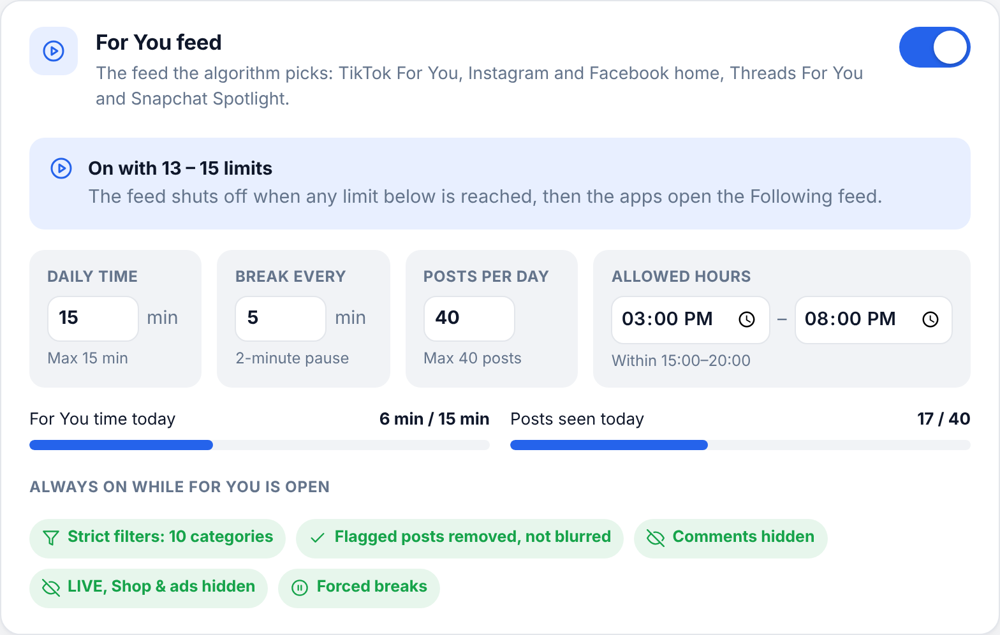

Under 13, the switch is greyed out and the card explains why:

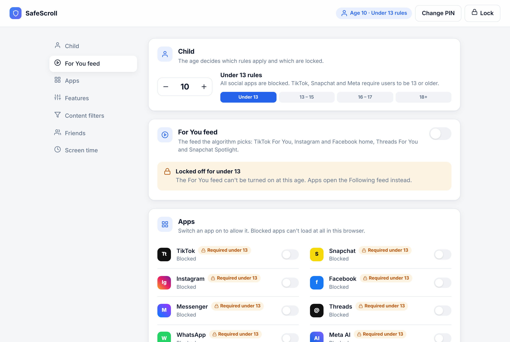

### 5. Set apps, features, filters, friends and screen time
- **Apps:** switch an app on to allow it.
- **Features:** each switch turns part of the apps off (Explore, LIVE, search, messages and so on).
- **Content filters:** choose categories, choose whether flagged posts are removed or blurred, and type your own words, pressing Enter after each.
- **Friends:** add the usernames your child may follow or add, pressing Enter after each.
- **Screen time:** set the daily limit and bedtime.

Then click **Save changes** in the bar at the bottom. Rules take effect in open tabs right away.

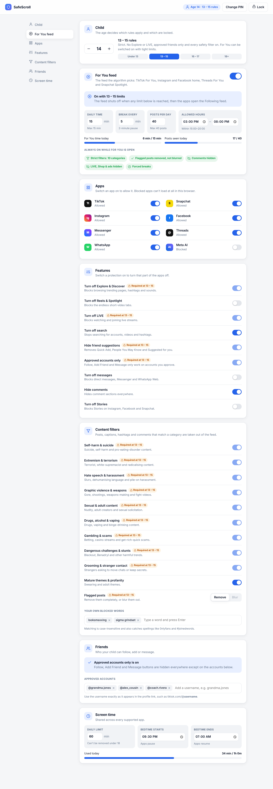

### 6. Lock it
Click **Lock** in the top bar. An unlock lasts 10 minutes. After that, saving asks for the PIN again. Five wrong PINs lock the page for 15 minutes. To stop your child simply removing the extension, apply `deploy/chrome-managed-policy.json` (see [Install](#install)).

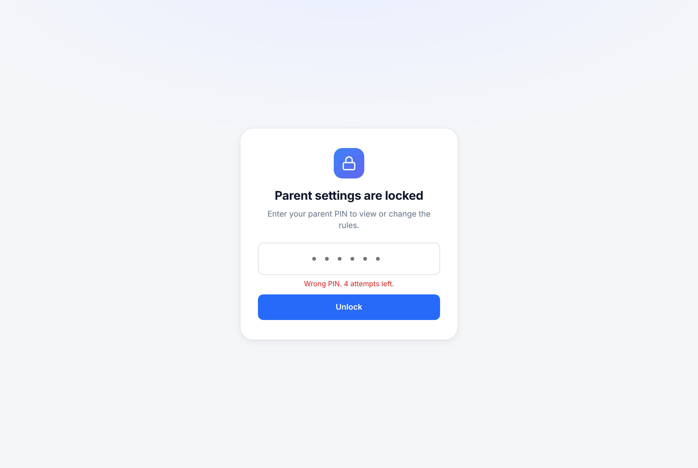

### What your child sees
| Toolbar popup | When For You time runs out |
|---|---|
| 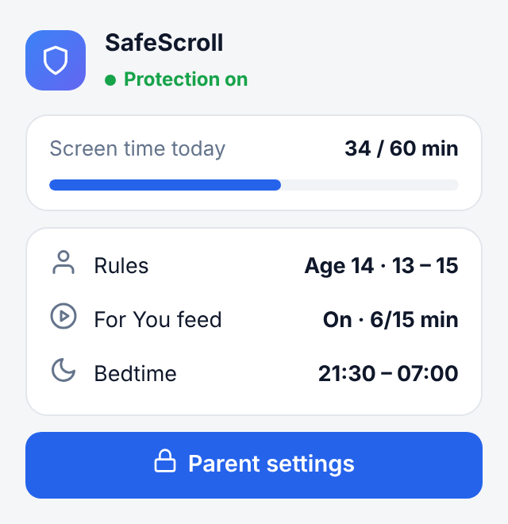 | 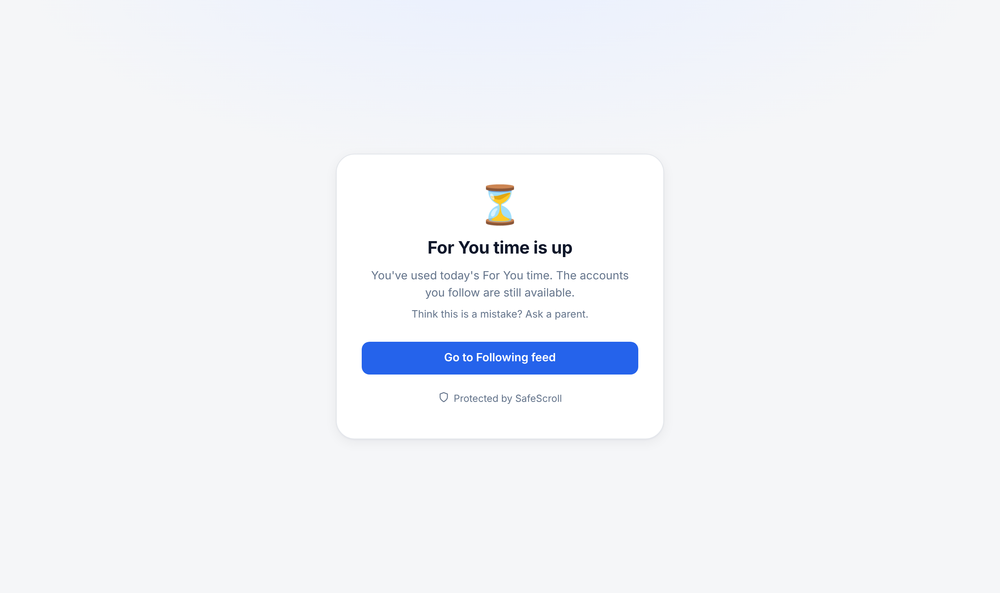 |

A forced break on the For You feed pauses all videos:

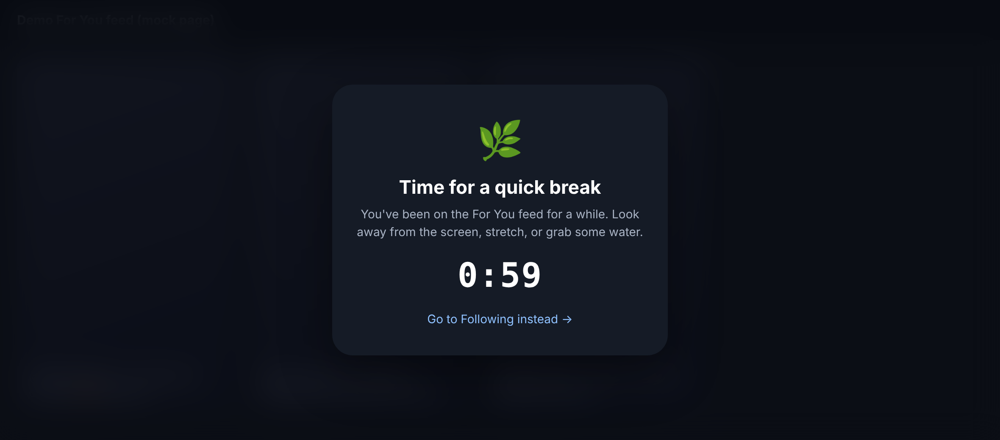

The page also has a dark theme and works on phone-width screens:

| Dark mode | Phone width |
|---|---|
| 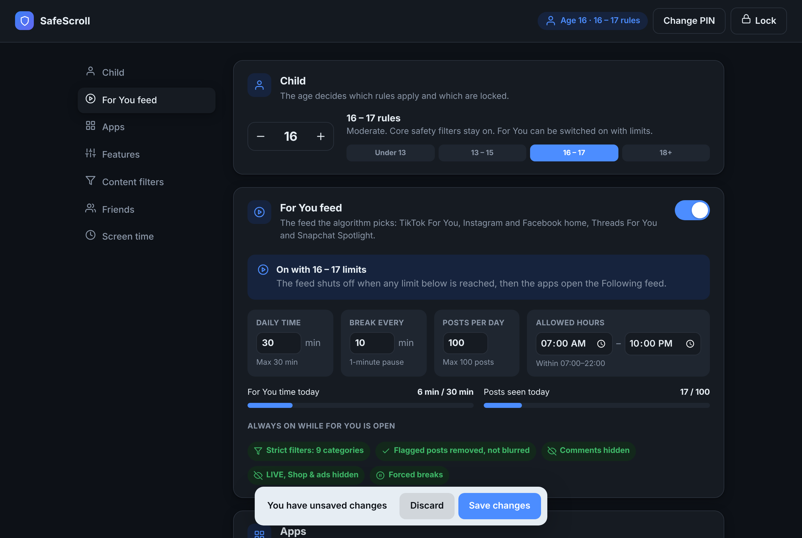 | 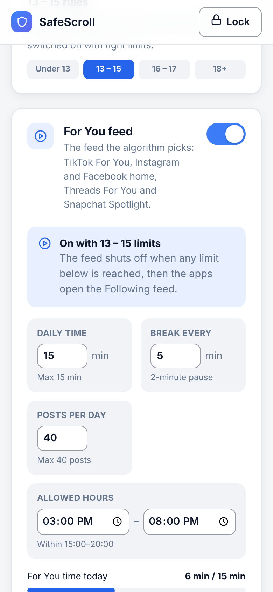 |

Screenshots come from the real extension running in Chromium (`node scripts/screenshots.mjs`). The break overlay and `11-filter-demo.png` were taken on a mock feed page, where a `#blackoutchallenge` post was removed and three safe posts stayed.

## Install

```bash
npm test          # runs the policy and filter tests
npm run zip       # builds safescroll.zip
```
1. Open `chrome://extensions` (or `edge://extensions`), turn on **Developer mode**, click **Load unpacked** and select `extension/`.
2. The setup page opens. Create a 6+ digit parent PIN and enter the child's age.
3. Lock it in place with `deploy/chrome-managed-policy.json`. This force-installs the extension and disables incognito, DevTools, guest mode and extra profiles. On a Chromebook, Google Family Link does the same.

Five wrong PIN attempts lock the settings for 15 minutes. The PIN is stored as a salted SHA-256 hash.

## Native apps (phones and tablets)
A third-party tool can't change the inside of the official iOS or Android apps. Apple and Google sandbox them, and modified copies of the apps break the platforms' terms and get accounts banned. For native apps:

1. **Block platforms at the network level.** Load `network/blocklist-hosts.txt` into NextDNS, a Pi-hole, AdGuard Home or your router. On mobile data, use the device's private DNS setting set to your NextDNS profile.
2. **Turn on each platform's own teen controls.** Together these cover what the extension does on the web:
   - **TikTok Family Pairing:** Restricted Mode, turn off search, limit who can message or comment, screen-time limits, keyword filters, and a STEM-only feed for younger teens.
   - **Snapchat Family Center:** see their friend list, report accounts, and turn on Content Controls to limit Stories and Spotlight.
   - **Meta Family Center / Teen Accounts** (Instagram, Facebook, Messenger, Threads): private-by-default account, Sensitive Content "Less", messages only from people they follow, Quiet Mode and time limits.
3. **Lock the device:** iOS Screen Time (App Limits, block app installs, Content Restrictions) or Android Family Link (approve apps, app limits, block sideloading and VPN apps).

## Honest limitations
No filter can **guarantee** that every harmful post is caught. Keyword filters miss content that is only in images or audio, and new slang appears all the time. The sites also change their page layouts, which can break the hiding rules in `extension/src/sites.js` until those are updated. Use SafeScroll as one strong layer alongside the platforms' own controls, device locks and conversations with your child.

## Project layout
```
extension/manifest.json        MV3 manifest
extension/src/policy.js        Age tiers, locked settings, override merging
extension/src/filters.js       Content categories + evasion-resistant matcher
extension/src/sites.js         Per-platform URLs/selectors (edit when sites change)
extension/src/content.js       Enforcement on the page
extension/src/background.js    Network-level blocking of blocked platforms
extension/options/             PIN-protected parent dashboard
extension/popup/               Toolbar popup
extension/blocked/             Page shown when something is blocked
extension/ui/                  Shared styles and icons
scripts/screenshots.mjs        Regenerates docs/screenshots with Playwright
network/blocklist-hosts.txt    DNS/hosts blocklist for native apps
deploy/                        Browser lock-down policies
tests/                         node --test suite
```
