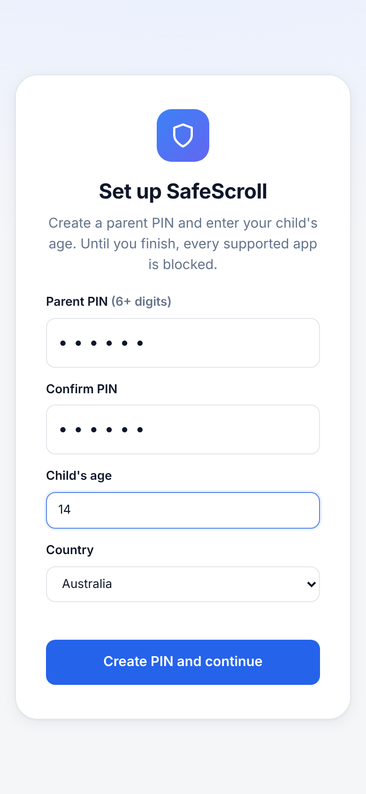
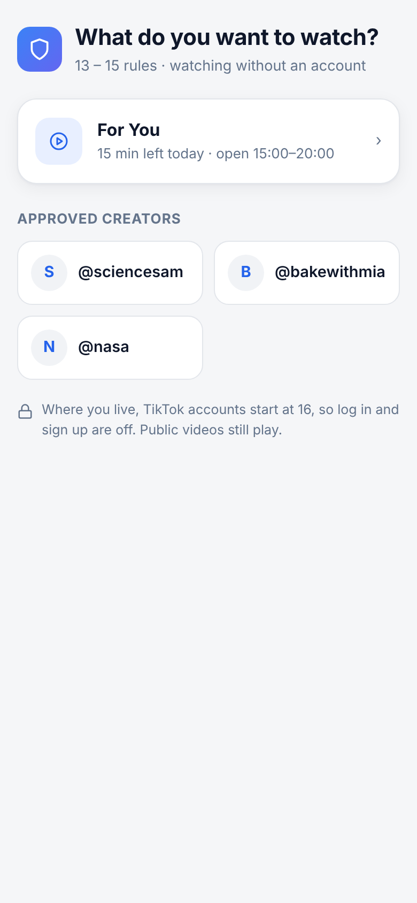
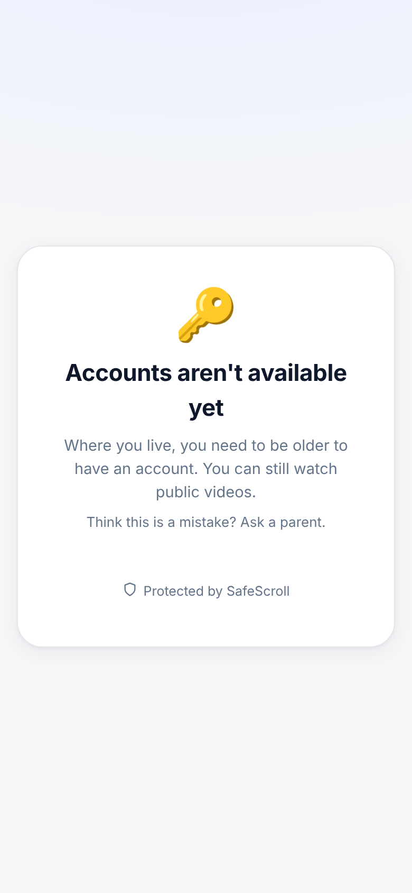

# SafeScroll for iPhone

A personal iPhone app that opens TikTok's mobile website inside the app with the SafeScroll filters, For You limits and parent settings built in. It reuses the browser extension's code (`../extension`), so the rules are identical in both.

> **Status:** written but not yet compiled. It was built in a Linux environment with no Xcode. The web parts (settings, home screen, filters, login blocking) are tested in Chromium with `node scripts/ios-web-check.mjs`. The Swift code needs its first build on a Mac. Expect to fix a few small compile errors there.

| Setup (in the app) | Home | Login blocked under 16 in Australia |
|---|---|---|
|  |  |  |

## What happens when you open it
1. **First launch:** the parent setup screen appears. Create a PIN and enter the age and country.
2. **Welcome screen** (native):
   - If accounts are allowed for that age and country: **Sign in**, **Create an account** or **Watch without an account**. Log in and sign up are TikTok's own pages, opened inside the app. The app never sees your password.
   - If they're not allowed (for example under 16 in Australia): **Start watching**, logged out.
3. **Main screen:** TikTok's mobile site with a bottom bar: **Back**, **Home**, **Reload** and **🛡 Settings**.
   - **Home** shows For You (with today's time left), Following (when logged in) and the approved creators from Settings.
   - **Settings** is the same parent dashboard as the extension, behind the PIN. Its **⋯** menu has **Sign out of TikTok**.

## What it does automatically
- **Filters run on every TikTok page:** content filters, For You limits and breaks, the approved-friends list, hidden suggestions, screen time and bedtime. These are the extension's scripts, injected into an isolated script world that TikTok's own code can't see.
- **Everything opens inside the app:**
  - "Continue with Apple / Google / Facebook / X" sign-in windows open as in-app sheets.
  - New-tab links open in the main view.
  - Alerts and prompts are native dialogs.
- **Stays on TikTok:** links to other websites, App Store links and "Open the TikTok app" links are blocked with a short message.
- **Respects the account age:** if the age or country changes so an account is no longer allowed, the app signs out of TikTok by itself.
- **Stays logged in between launches**, like Safari.
- **Camera, microphone and photos** work for uploading. iOS asks the first time.

## What you need
| | |
|---|---|
| A Mac with **Xcode 15 or newer** | Free from the Mac App Store |
| **XcodeGen** | Install with `brew install xcodegen` (needs [Homebrew](https://brew.sh)) |
| An **Apple ID** | Free works. Apps signed with a free account expire after **7 days** and need re-installing from Xcode. A paid Apple Developer account (US$99 a year) makes it last a year. |
| An **iPhone** on iOS 16 or newer, plus a cable | Turn on **Developer Mode**: Settings → Privacy & Security → Developer Mode (appears after the first install attempt) |

## Build and install
```bash
cd ios
xcodegen            # creates SafeScrollTok.xcodeproj from project.yml
open SafeScrollTok.xcodeproj
```
1. In Xcode, select the **SafeScrollTok** target, open **Signing & Capabilities**, tick **Automatically manage signing** and pick your Apple ID under **Team**. Add it in Xcode → Settings → Accounts if it isn't listed.
2. If Xcode says the bundle identifier is taken, change it to something unique, such as `com.yourname.safescroll`.
3. Plug in the iPhone, choose it as the run destination at the top, and press **▶ Run**.
4. The first time, the iPhone will ask you to trust the developer: Settings → General → VPN & Device Management → your Apple ID → **Trust**.

## Making it the only way TikTok is used (optional)
On the child's iPhone, in **Screen Time**:
- **Hide the real TikTok app:** Content & Privacy Restrictions → iTunes & App Store Purchases → Installing Apps: **Don't Allow**, after deleting the TikTok app.
- **Block TikTok in Safari:** Content & Privacy → Store, Web, Siri & Game Center Content → Web Content → Limit Adult Websites, and add `tiktok.com` under **Never Allow**. That doesn't affect this app, which has its own web view.
- **Stop the app being deleted:** iTunes & App Store Purchases → Deleting Apps: **Don't Allow**.

## Limits
- **Not for the App Store:** it's a wrapper around another company's website, so it's for your own phone and isn't meant for publishing. Apple would almost certainly reject it.
- **TikTok's mobile website does less than the TikTok app:** recording and editing is limited, and some features show "open the app" prompts. The app blocks those prompts from leaving.
- **TikTok changes its site often:** if something stops being hidden, update the selectors in `extension/src/sites.js` and rebuild. You can inspect the live page from a Mac via Safari → Develop → your iPhone → SafeScroll.
- **Keyword filters read text, not video:** they catch captions, hashtags and comments, not what's only shown in the video or audio.

## How it fits together
```
ios/SafeScrollTok/
  App.swift        App state, first-run flow, welcome screen, main screen, settings sheet
  Browser.swift    TikTok web view: injected filters, which pages may open, in-app popups, dialogs
  Bridge.swift     chrome.storage for the web pages + bundled-file server (safescroll://app/…)
  Store.swift      Saved settings (UserDefaults) and the shared policy.js run natively
  Web/             chrome-shim.js (chrome.* stand-in) and the Home screen
extension/         Bundled as-is: filters, policy, site rules, settings UI, blocked page
```
Only the settings screen (behind the PIN) can change rules or the PIN. TikTok's page code can't reach the app's storage at all, and the filter scripts can only update the screen-time counters.
